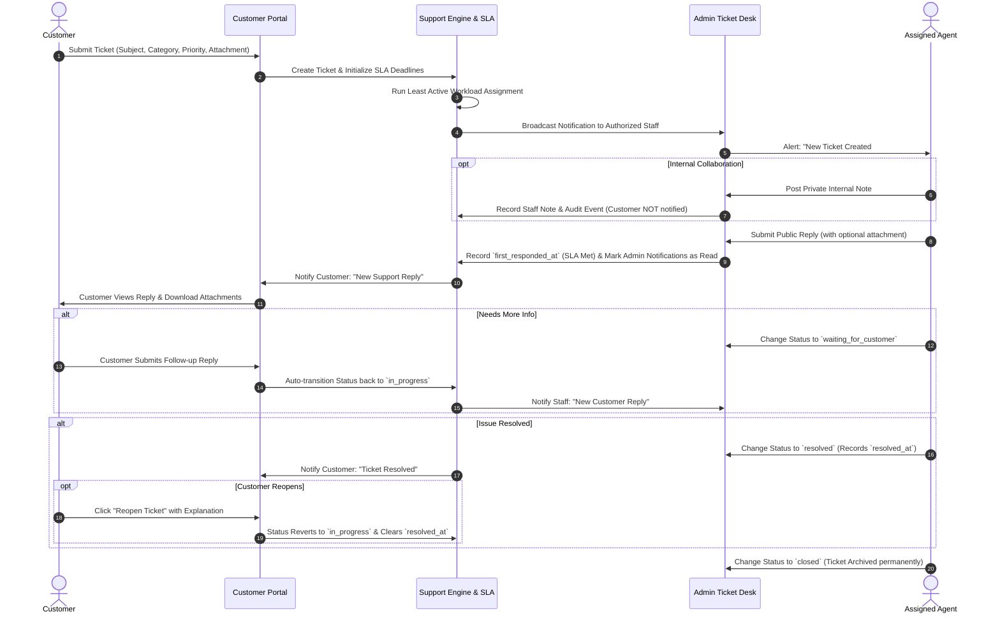

# Support Lifecycle & Application Flow

| 🚀 [Installation Guide](installation.md) | 🔑 [Demo Accounts](demo-accounts.md) | ⚡ [Core Features](features.md) | 🔄 [Application Flow](application-flow.md) | 🧪 [Testing Guide](testing-guide.md) |
| :---: | :---: | :---: | :---: | :---: |

---

This document outlines the end-to-end lifecycle of a support ticket, detailing how data, events, notifications, and permissions flow between customers and support staff.

---

## High-Level Lifecycle Diagram

---

## Detailed Step-by-Step Flow

### Step 1: Ticket Creation & Auto-Initialization
1. An authenticated customer accesses `/customer/tickets/create`.
2. The customer provides a subject, chooses a department/category, selects a priority, types the issue description, and optionally uploads files.
3. Upon submission:
   - A unique identifier is assigned (e.g., `TCK-20261108-RRPL`).
   - The SLA engine calculates `first_response_due_at` and `resolution_due_at` based on the selected priority, business hours (e.g., 9:00 AM – 5:00 PM), and working days in the configured timezone.
   - If submitted outside working hours or on a weekend, the SLA clock automatically starts at the beginning of the next active working day.
   - A `created` event is recorded in the ticket activity audit log.

### Step 2: Automatic Workload Assignment
1. If the ticket is unassigned and auto-assignment is active, the `TicketAssignmentService` triggers.
2. It queries all active internal users (`account_type = 'admin'`) who possess the dynamic `receive_ticket_assignments` permission.
3. It tallies each agent's active workload (tickets with status `open`, `in_progress`, or `waiting_for_customer`).
4. The ticket is immediately assigned to the agent carrying the least active workload.
5. The assignment is logged to the ticket's history timeline.

### Step 3: Notification Dispatch
1. A **New Ticket Created** notification is generated.
2. It is dispatched to all active staff members holding `view_ticket` permission.
3. The notification contains a direct link to `/admin/tickets/{id}`.

### Step 4: Staff Review & Collaboration
1. The assigned agent opens the ticket in the Admin Panel.
2. **Internal Note Option**:
   - If the agent needs to collaborate with a colleague or record internal investigation details, they toggle **Internal Note**.
   - The note is saved with a warning badge ("Private internal note — staff only").
   - **Privacy Guarantee**: This note is strictly omitted from customer views and customer activity streams. Customers never receive an alert for internal notes.
3. **Public Reply Option**:
   - The agent enters their response and optionally attaches files.
   - Upon submitting:
     - The message is saved as a public reply.
     - If this is the first staff response, `first_responded_at` is stamped, marking the First Response SLA milestone as **Completed**.
     - All unread admin-side notifications for this ticket are globally marked as read across all staff members.
     - A notification is sent to the customer.

### Step 5: Customer Feedback & Status Lifecycle
1. The customer receives a notification and views the agent's reply in their portal.
2. **If Staff Requested Information**:
   - The staff member sets the status to `waiting_for_customer`.
   - The customer sees a badge indicating their response is needed.
   - As soon as the customer replies, the system automatically shifts the status back to `in_progress` and alerts staff that a customer reply has arrived.

### Step 6: Automated SLA Monitoring & Escalation
1. The background scheduler runs every 5 minutes (`ticket:escalate-sla`).
2. If `now()` passes `first_response_due_at` before an agent replies publicly, the ticket milestone is marked **Breached**.
3. **Level 1 Escalation**: Sends breach alert notifications to the assigned staff member and administrator.
4. **Level 2 Escalation**: If the ticket remains unaddressed past the configured breach threshold (e.g., 60 minutes), the system reassigns the ticket to the next least-busy agent and logs the escalation event.

### Step 7: Resolution & Archival
1. Once the issue is resolved, staff changes the status to `resolved`:
   - `resolved_at` is stamped.
   - The Resolution SLA milestone is marked **Completed**.
   - The customer is notified that their issue is marked resolved.
2. **Customer Reopen Window**:
   - If the issue persists, the customer can click **Reopen Ticket** on their portal and enter a reason.
   - The ticket returns to `in_progress` and `resolved_at` is reset to null.
3. **Permanent Closure**:
   - After resolution confirmation or inactivity, staff transitions the ticket to `closed`.
   - The ticket is archived. No further replies or modifications can be submitted.

---

## Role & Action Permissions Matrix

| Action | Customer (`customer`) | Support Staff (`admin` with permissions) | Super Admin (`admin`) |
| :--- | :---: | :---: | :---: |
| **Submit New Ticket** | ✅ (Own account) | ✅ (On behalf of any customer) | ✅ |
| **Post Public Reply** | ✅ (Own tickets only) | ✅ (Requires `reply_ticket`) | ✅ |
| **Post Private Internal Note** | ❌ (Strictly prohibited) | ✅ (Requires `internal_note_ticket`) | ✅ |
| **Download Public Attachments** | ✅ (Own tickets only) | ✅ (Requires `view_ticket`) | ✅ |
| **Download Internal Note Attachments** | ❌ (Strictly prohibited) | ✅ (Requires `internal_note_ticket`) | ✅ |
| **Manual Reassign Ticket** | ❌ | ✅ (Requires `assign_ticket`) | ✅ |
| **Receive Auto-Assignment** | ❌ | ✅ (Requires `receive_ticket_assignments`) | ✅ (If permission granted) |
| **Change Ticket Priority** | ❌ | ✅ (Requires `edit_ticket`) | ✅ |
| **Reopen Resolved Ticket** | ✅ (Own tickets only) | ✅ | ✅ |
| **Permanently Close Ticket** | ❌ | ✅ (Requires `edit_ticket`) | ✅ |
| **Configure SLA & Business Hours** | ❌ | ❌ | ✅ |
| **Bulk Import CSV Tickets** | ❌ | ❌ | ✅ |
| **View System Audit Logs** | ❌ | ❌ (Requires `view_activity_log`) | ✅ |

